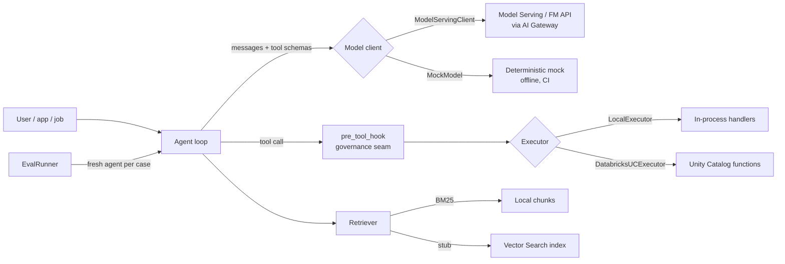

# databricks-agent-kit

**A runnable starter kit for building production-grade agents on Databricks** —
tools declared once as Unity Catalog-style functions, an agent loop you can
read end-to-end, a Model Serving client, a RAG baseline, and an eval harness
that runs in CI with no workspace at all.

> Most agent tutorials stop at a demo notebook that only runs in the
> author's workspace, against the author's endpoint, with no tests and no
> evals. This kit is the opposite starting point: clone it anywhere, run it
> offline in a minute, then swap the mock pieces for real Databricks ones —
> model endpoint, Unity Catalog functions, Vector Search — without
> rewriting the agent.


## Quickstart (< 5 commands)

```bash
git clone https://github.com/ash1sh95/databricks-agent-kit && cd databricks-agent-kit
pip install -e .
PYTHONPATH=src:. python examples/workspace_insight_agent.py   # full agent, offline
PYTHONPATH=src:. python examples/run_evals.py                # 8 cases, scored
pytest -q                                                      # 25 tests
```

Zero required dependencies — the core is pure stdlib Python 3.10+.
Databricks, MLflow and LangGraph are optional extras behind interfaces.

## What you get

| Piece | Where | Production counterpart |
|---|---|---|
| Tool registry (UC-style specs) | `src/agent_kit/tools.py` | Unity Catalog functions — one spec generates the model schema, the local handler, and `CREATE FUNCTION` DDL |
| Agent loop | `src/agent_kit/agent.py` | Plain-Python reference loop + optional LangGraph graph (Mosaic AI Agent Framework path) |
| Model clients | `src/agent_kit/model.py` | `ModelServingClient` for Model Serving / Foundation Model APIs via AI Gateway; `MockModel` (deterministic) everywhere else |
| RAG | `src/agent_kit/rag.py` | Chunking + dependency-free BM25 baseline; Vector Search (Delta Sync index) behind the same interface |
| Evals | `src/agent_kit/evals.py`, `evals/dataset.jsonl` | Local scorer in CI; same dataset logged to an MLflow experiment in a workspace |
| Governance seam | `Agent(pre_tool_hook=...)` | [agent-control-plane](https://github.com/ash1sh95/agent-control-plane)'s judge-before-action gate — see `examples/gated_agent.py` |
| Deploy | `databricks/` | Notebook with widgets, Asset Bundle skeleton, 15-minute guide |

## Architecture



Full diagram, seams and rationale: [docs/architecture.md](docs/architecture.md) ·
Platform mapping (UC functions, AI Gateway, MLflow, Vector Search, Asset
Bundles): [docs/patterns.md](docs/patterns.md)

## Demo output (real run)

The example agent answers questions over synthetic system-table-like data
(billing usage, job runs) and team documentation:

```
[question] What is our total billing cost and spend this month?
[tool_call] query_billing({})
[tool_result] query_billing -> total spend $1,424.95 across 6 usage rows (databricks $1,286.10, model-serving $96.75, vector-search $42.10)
[final] Based on query_billing: total spend $1,424.95 across 6 usage rows ...

[question] Which jobs failed — show me the failing job runs?
[tool_call] query_failed_jobs({})
[tool_result] query_failed_jobs -> 3 failed or timed-out jobs: feature-refresh (FAILED, 7 min, team-ml); model-retrain (FAILED, 31 min, team-ml); nightly-export (TIMEOUT, 90 min, team-analytics)

[question] What does the documentation say about data retention policy?
[tool_call] search_docs({'query': 'what does the documentation say about data retention policy?'})
[tool_result] search_docs -> from doc 'retention' (bm25 3.3618): # Data retention guideline
Raw landing tables are retained for 90 days. Curated Delta tables ... retained for 400 days ...
```

## Eval results (real run, 2026-10-25)

8 cases over the example agent — billing, failed jobs, documentation RAG,
and one "should not call a tool" case:

| Metric | Result |
|---|---|
| Pass rate | **8/8 = 100.0%** |
| Unit tests | **25 passed** (`pytest -q`) |
| Lint | `ruff check` clean |

Methodology — score the tool chosen and the facts returned, not the
phrasing: [docs/evals.md](docs/evals.md). The mock model is deterministic,
so a failing case in CI is a system regression, never flakiness.

## Use it on Databricks in 15 minutes

Add the repo as a Git folder, open
[`databricks/01_agent_kit_on_databricks.py`](databricks/01_agent_kit_on_databricks.py),
set three widgets (catalog / schema / experiment), run all: tool DDL for
Unity Catalog, the agent running (mock first, your Model Serving endpoint
when you set the widget), eval results in MLflow and optionally Delta.
An Asset Bundle skeleton for repeatable deploys is beside it.
Guide: [databricks/README.md](databricks/README.md)

## The suite: build → govern → observe → evaluate

This kit is project 2 of a four-repo suite on production agents:

- **Build** — this repo.
- **Govern** — [agent-control-plane](https://github.com/ash1sh95/agent-control-plane):
  judge-before-action gate, rate limits, approvals, audit. Composes via
  this kit's `pre_tool_hook` (`examples/gated_agent.py`).
- **Observe** — [dspy-observability-dashboard](https://github.com/ash1sh95/dspy-observability-dashboard):
  MLflow-based cost / latency / error observability for LLM pipelines.
- **Evaluate in situ** — [databricks-insight-agent](https://github.com/ash1sh95/databricks-insight-agent):
  a worked example agent over Databricks system tables.

How they fit together: [docs/suite.md](docs/suite.md)

## LIMITS (labelled, on purpose)

- **MockModel is a test double, not intelligence.** Keyword intent →
  one tool → summary. It exists so the *system* is testable offline;
  real behaviour comes from your endpoint.
- **Databricks executors/retrievers are interface stubs.** UC execution
  and Vector Search raise with exact instructions outside a workspace;
  SQL/DDL generation and the interfaces are real and tested.
- **BM25 is a baseline.** Good enough to evaluate chunking and to beat in
  a workspace with Vector Search — not a claim that keyword search is
  production RAG.
- **The local eval scorer is a floor.** Substring + tool-choice checks are
  auditable and deterministic; judge-based scoring belongs in MLflow /
  Databricks agent evaluation on top of the same dataset.
- **Sample data is synthetic.** CSVs mimic system-table shapes
  (billing usage, job runs); no real workspace data is included.
- **YAML-lite config is a subset.** Nested maps + scalars only — enough
  for kit/bundle-shaped config without a PyYAML dependency.

## Project layout

```
src/agent_kit/    config · tools (registry/executors) · model (mock + Model Serving)
                  agent (loop + LangGraph path) · rag (chunk/BM25/Vector Search stub)
                  evals (dataset, runner, MLflow logging)
examples/         workspace-insight agent · gated variant · eval runner · sample data/docs
evals/            8-case JSONL dataset for the example agent
databricks/       deploy notebook · Asset Bundle · 15-minute guide
docs/             architecture · patterns · eval guide · suite story
tests/            25 pytest tests (registry, retriever, evals, agent loop, config)
```

## Roadmap

- [ ] Streaming responses in the Model Serving client
- [ ] MLflow tracing exporter for `AgentResult.trace` spans
- [ ] Vector Search retriever implementation behind the extra
- [ ] Multi-tool / multi-step mock scenarios for richer evals
- [ ] DSPy-optimised prompts example for the insight agent

## Contributing

PRs welcome — especially new eval cases. House rule: **a failure becomes
an eval case before it becomes a fix.** See [CONTRIBUTING.md](CONTRIBUTING.md).

## License

MIT © Ashish Arun

---
*Built by Ashish Arun — Technical Principal, Data & AI (Dallas). Suite:
build → govern → observe → evaluate production agents on Databricks.*
