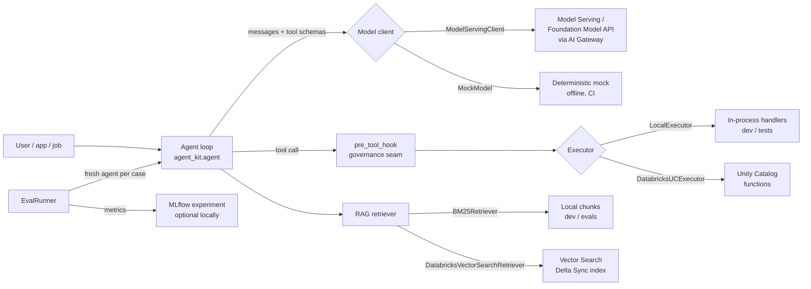

# Architecture

## The four seams

Every production concern plugs in at a seam, without rewriting the agent:

1. **Model seam** (`ModelClient`) — mock locally, a Model Serving /
   Foundation Model API endpoint in a workspace. AI Gateway sits in front
   of the endpoint in production and is invisible to agent code.
2. **Tool seam** (`ToolRegistry` + executor) — one UC-style spec drives the
   LLM schema, the local handler and the UC `CREATE FUNCTION` DDL, so the
   three cannot drift.
3. **Retrieval seam** (`Retriever`) — BM25 baseline you can read and test;
   Vector Search in a workspace, same `search(query, k)` shape.
4. **Governance seam** (`pre_tool_hook`) — every tool call passes one
   callable before execution. That is where agent-control-plane's gate
   attaches (see `examples/gated_agent.py`).

## Why a plain-Python reference loop

Frameworks (LangGraph included) hide the loop. The loop is where cost,
loops-without-progress, and un-governed tool calls actually happen, so the
kit teaches it explicitly, then shows the same trio (registry, executor,
model) wrapped in a LangGraph graph for teams standardising on it.
